# BornHack CyberÆgg Badge Firmware

Embassy-based async firmware for the BornHack CyberÆgg badge (nRF52840).

This is the community edition. The canonical repository is
[Ranzbak/bornhack-firmware-2026-ce](https://codeberg.org/Ranzbak/bornhack-firmware-2026-ce)
on Codeberg. A public mirror on GitHub,
[ranzbak/bornhack-firmware-2026-ce](https://github.com/ranzbak/bornhack-firmware-2026-ce),
runs the tests (see [Tests and CI](#tests-and-ci)).

## Screenshots

These are real screens of this firmware, rendered by the simulator at four
times the badge's 152×152 pixels. `make readme-shots` renders them again
(see [Player's guide](#players-guide)).

### BornPets

Six pets to pick from, each with its own sprites.

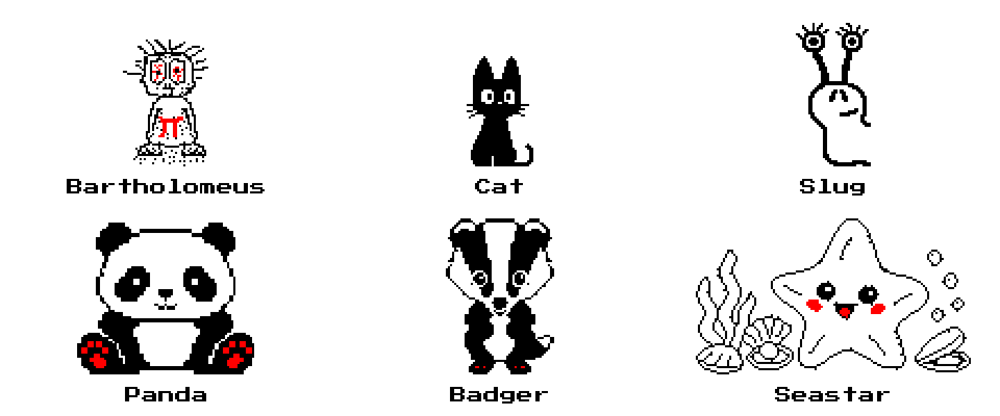

An egg hatches and you give the pet a name with the joystick keyboard.

<table>
<tr>
<td>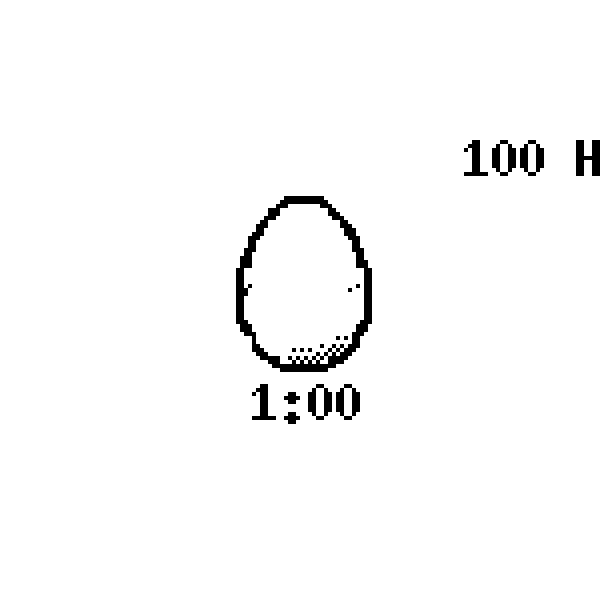</td>
<td>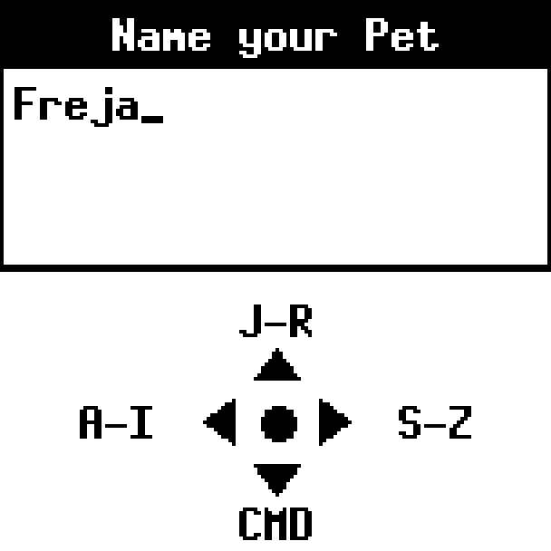</td>
<td>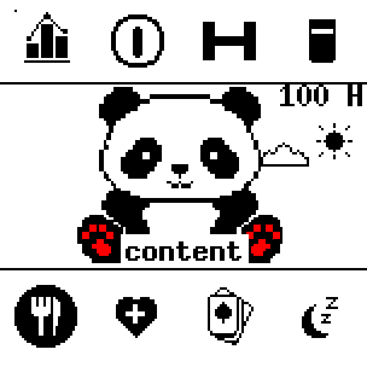</td>
</tr>
</table>

The sky follows the badge clock, and the floor fills up with mess when the pet
is not kept clean.

<table>
<tr>
<td>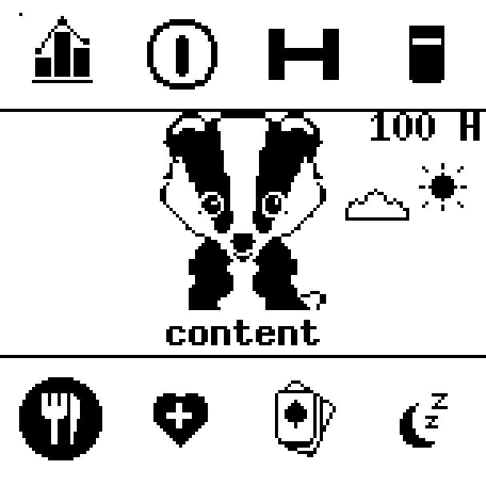</td>
<td></td>
<td>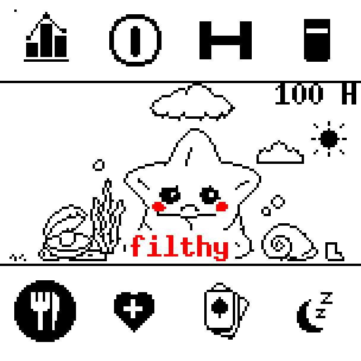</td>
</tr>
<tr><td>Day</td><td>Night</td><td>Filthy</td></tr>
</table>

Reading the pet: every need has a band where the pet is content, the Diary
keeps what happened, and a toast says why something went wrong.

<table>
<tr>
<td>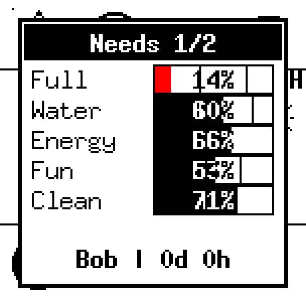</td>
<td>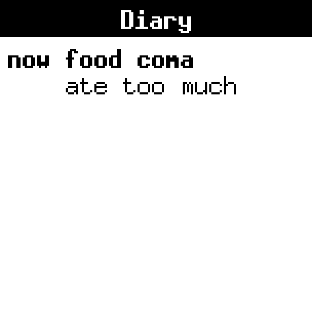</td>
<td></td>
</tr>
<tr><td>Needs</td><td>Diary</td><td>Cause toast</td></tr>
</table>

The care menus warn before a choice does harm, refuse what makes no sense and,
in Hard mode (US), charge US prices (a Hamburger in place of the Frikandel).

<table>
<tr>
<td>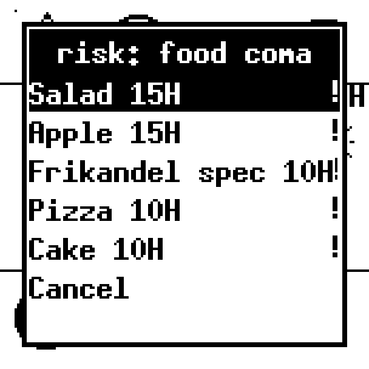</td>
<td>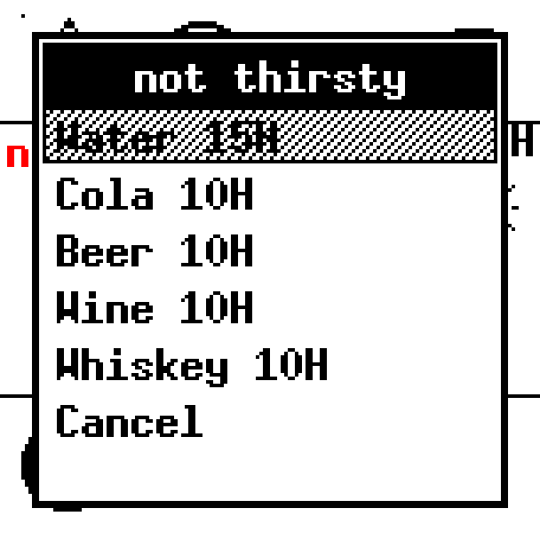</td>
<td>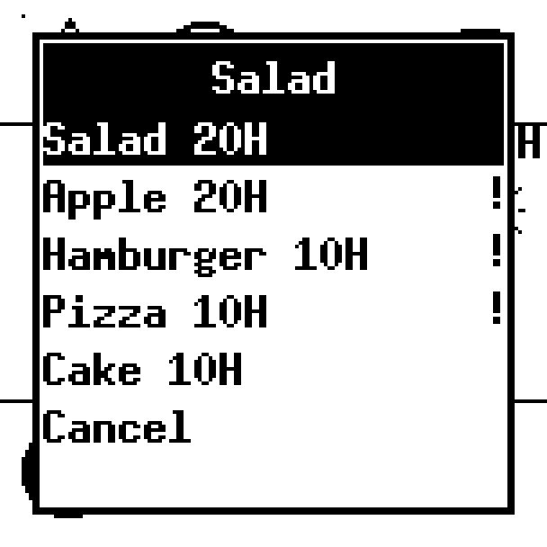</td>
</tr>
<tr><td>Risk marks</td><td>Refusal</td><td>Hard mode (US)</td></tr>
</table>

Conditions with their own pictures: a hangover, an injury, hunger.

<table>
<tr>
<td>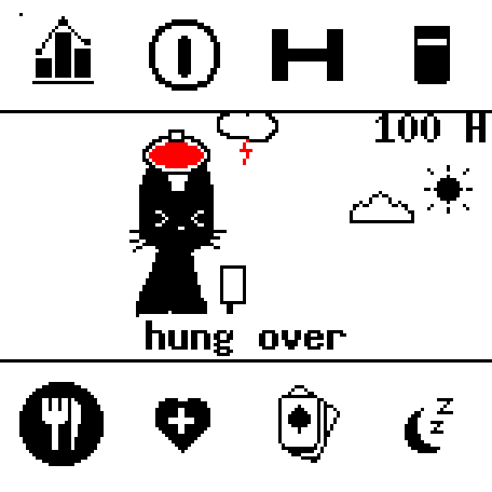</td>
<td>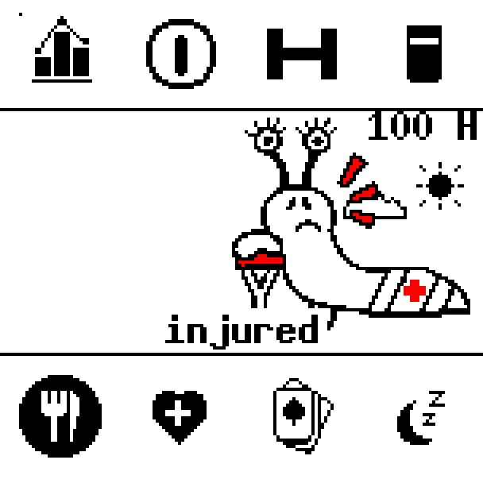</td>
<td></td>
</tr>
<tr><td>Hung over</td><td>Injured</td><td>Starving</td></tr>
</table>

Demo mode makes a desk companion that looks after itself. Friends on the mesh
can be challenged to a Battle. A pet whose sprites are gone moves to the
Unicorn Realm.

<table>
<tr>
<td>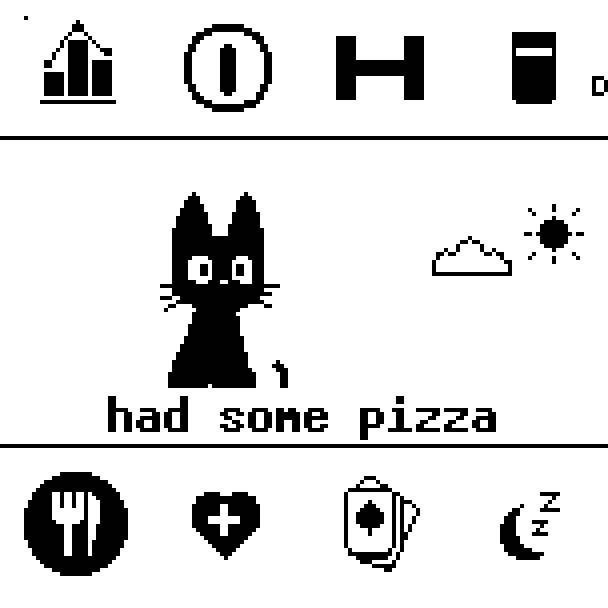</td>
<td>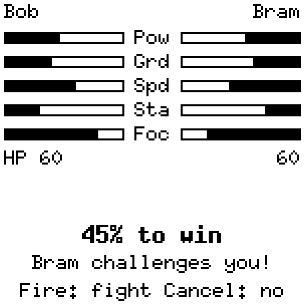</td>
<td></td>
</tr>
<tr><td>Demo mode</td><td>Battle</td><td>Unicorn Realm</td></tr>
</table>

### The rest of the badge

<table>
<tr>
<td></td>
<td>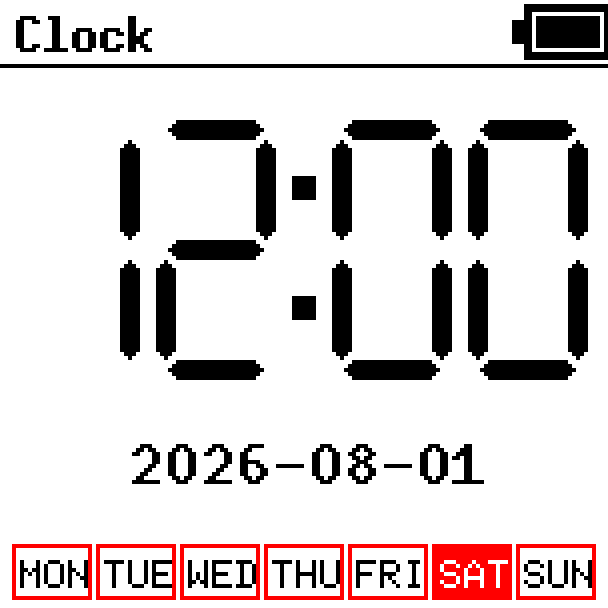</td>
<td>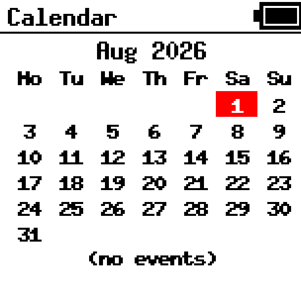</td>
<td>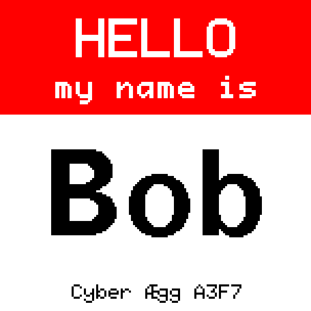</td>
</tr>
<tr><td>Start screen</td><td>Watch</td><td>Calendar</td><td>Name tag</td></tr>
</table>

## What's different in this fork

This fork extends the upstream CyberÆgg firmware,
[Ranzbak/bornhack-firmware-2026](https://codeberg.org/Ranzbak/bornhack-firmware-2026),
with a new BornPets game and some mesh features. Here is what changed.

### BornPets v3

The game engine was rebuilt (the "v3" engine). Everything below is on `main`.

- **Needs with comfort bands** — every need (Full, Water, Energy, Fun, Clean,
  and so on) has a band where the pet is content. Too little and too much are
  both bad. Actions move a need by a dose, so overdoing a treat hurts too.
- **Reading the pet** — a two-page stats view with band ticks, a status line
  under the pet (`hungry`, `no insulin`, `content`, ...), cause toasts that
  say why an action ended badly, a `!` risk mark on menu rows, and a Diary of
  recent events (Stats > Diary).
- **Classic and Casual** — two rule sets. Casual decays slower and forgives
  more. Individual numbers can be overridden with `BPETS_V3.CFG` on the
  badge's USB drive. The shipped, commented template is
  [`assets/to-badge/BPETS_V3.CFG`](assets/to-badge/BPETS_V3.CFG).
- **Weight and Type 2 diabetes** — a slow, multi-day weight stat. Sustained
  neglect triggers diabetes. **Insulin** manages it. **Ozempic** is a
  stronger weight-loss treatment with a long cooldown.
- **Food and drinks** — Feed offers Salad, Apple, Frikandel speciaal, Pizza
  and Cake. Drink offers Water, Coffee, Beer, Wine and Whiskey. Heavy drinking
  leads to dependence, cleared by a **Rehab** course. Exercise, Relax and
  Wash are separate actions.
- **Demo mode** — a self-caring desk-companion pet that looks after itself
  and says what it did. HAX is paused while it is on.
- **Sky and floor** — the game screen has a day or night sky that follows the
  badge clock, and items pile up on the floor as the pet gets dirty.
- **HAX economy** — an optional in-game currency. Choose "With money" at pet
  select. Earn HAX from mini-game wins, Battle wins and the **OnlyPets** work
  action; spend it on food, drinks and treatments.
- **Hard mode (US)** — a third pet-select option where healthy choices cost
  more and treatments are pricier. The Frikandel speciaal is relabelled a
  **Hamburger**.
- **Pets from `PETS.CFG`** — no pet is built into the firmware. The roster
  is read from `PETS.CFG` on the USB drive. The shipped roster is
  Bartholomeus, Cat, Slug, Panda, Badger and Seastar. The Jellyfish was
  removed. A pet with no sprites on the badge moves to the **Unicorn Realm**.
- **Debug cheat menu** — a hidden button sequence (Up Up Down Down Left Right
  Left Right Fire) opens a testing menu with instant need and condition
  triggers and a time-skip, so the multi-day arcs can be tested in seconds.

The player's guide is the best description of how it plays:
**[read the PDF](guide/bornpets-guide.pdf)**. [GAME.md](GAME.md) has the
rules in markdown.

### Mesh social features

- **Friends** — every badge auto-joins a private `SHDW` mesh channel and
  broadcasts a presence beacon every 15 minutes. Meeting another SHDW
  badge for the first time (or again after a few hours apart) boosts
  your pet's happiness. **Stats > Friends** is a clickable menu, sorted
  most-recently-seen-first — pick a friend to see how long you've known
  them, their cached combat stats, and your head-to-head Battle record
  against them.
- **Battles** — every pet has Attack/Defense/Speed/HP derived
  automatically from its care stats and traits. Challenge anyone on your
  Friends list for an instant fight, resolved locally using your live stats
  plus their most recently broadcast combat snapshot — no waiting on the
  other badge. Battle HP is entirely separate from real pet health; losing
  costs nothing but bragging rights. Win/loss records sync between both
  badges automatically.

### Display tooling

- **Force screen flush** — a hidden combo (Down Down Up Up Right Left
  Right Left Fire, the debug cheat combo run in reverse) that forces a
  full black → white → redraw de-ghost cycle on demand, on whichever
  screen is showing. It works on any screen, with no pet active.
- **Two panel variants** — the SSD1675 panel (`fw*` builds) and the SSD1680
  panel (`fw-1680*` builds). See [Build](#build).

### Removed

- **Sponsor slideshow** — removed (boot sequence, menu items and the
  firmware code that showed it). Prefix `03` stays reserved for its images.
- **Jellyfish pet** — removed from the shipped roster and assets.

### Corrections vs upstream

This fork also fixed bugs in shared firmware paths it inherited from
upstream. Anyone comparing behaviour against upstream should know about these:

- **Duplicate mesh-packet delivery** — `GrpData` payloads (Friends beacons,
  Battle results) had no duplicate suppression, so a packet arriving by
  more than one mesh path was processed once per path. There is now a dedup
  ring.
- **FAT12 reserved cluster values** — a corrupt chain entry of `0x001` or
  `0xFF0`–`0xFF7` is now flagged as corrupt instead of read as a real
  cluster.
- **BornJeweled no-op swaps** — swapping two gems that form no match now
  reverts, as standard match-3 rules say, instead of using up a move.
- **Contact store locking** — multi-step flash writes to the mesh contact
  store are serialised, so two tasks adding a contact at once cannot drop one.
  `tests/flash_concurrency.rs` covers it.
- **Pending mesh request tags expire** — a request that never gets a reply
  no longer leaves its tag valid forever.
- **Friends "Met" / "Last seen"** — the timestamps are rebased after a
  reboot, because the uptime clock restarts at zero.
- **Menu wrap-around** — scrolling menus wrap from the top item to the
  bottom and back instead of stopping at the ends.

### Full changelog

[FEATURES.html](FEATURES.html) has a dated feature log of this fork (written in
July 2026), including mesh protocol details and the writeup of each fix
above. [CHANGELOG-2026-07-14-to-16.md](CHANGELOG-2026-07-14-to-16.md) covers
those three days. [CHANGELOG.md](CHANGELOG.md) lists the changes per
release, starting with the MeshCore 1.16 → 1.18 work. For anything newer,
read `git log`.

Features and bug fixes in this repository were partly written with A.I.

______________________________________________________________________

## First use (badge holders)

If you just got a badge, start here:

| Document                                 | Description                                                                      |
| ---------------------------------------- | -------------------------------------------------------------------------------- |
| **[QUICKSTART.md](QUICKSTART.md)**       | Power on, pair, set the time, charge, recover, USB drag-drop                     |
| **[POCKET_CARD.md](POCKET_CARD.md)**     | One-page printable reference — buttons, LEDs, combos                             |
| **[FAQ.md](FAQ.md)**                     | Why the red LED blinks, which screen saves battery, inverted/ghosted screen, DFU |
| **[USER_WATCH.md](USER_WATCH.md)**       | Watch face, alarms, calendar, time sync                                          |
| **[USER_GAMES.md](USER_GAMES.md)**       | BornPets virtual pet + four mini-games                                           |
| **[USER_MESH.md](USER_MESH.md)**         | LoRa mesh: adverts, PMs, channels, identity QR                                   |
| **[USER_CONTACTS.md](USER_CONTACTS.md)** | Contacts list, filters, saving, blocking                                         |
| **[USER_NFC.md](USER_NFC.md)**           | NFC station taps via the BadgeCtl app                                            |

**Playing BornPets? Read the [player's guide (PDF)](guide/bornpets-guide.pdf).**
The rest of this README is developer-facing.

## Hardware

| Component  | Part                                | Interface      |
| ---------- | ----------------------------------- | -------------- |
| MCU        | nRF52840                            | —              |
| Display    | SSD1675 or SSD1680 e-paper, 152x152 | SPI3           |
| LoRa radio | SX1262                              | SPI2           |
| BLE        | nRF52840 built-in                   | nrf-sdc / MPSL |

## Default LoRa radio settings

Out of the box the badge joins **EU/UK Narrow**, the stock MeshCore channel, so it
shares airtime with unmodified MeshCore nodes:

| Parameter        | Default     |
| ---------------- | ----------- |
| Frequency        | 869.618 MHz |
| Bandwidth        | 62.5 kHz    |
| Spreading factor | SF8         |
| Coding rate      | 4/5         |
| TX power         | 22 dBm      |
| Client repeat    | off         |

All of these are overridable from the on-device Settings menu or the companion app,
and the chosen values persist to flash. TX power defaults to the SX1262 maximum of
22 dBm — the badge antenna is not fully efficient, so radiated power stays within the
band limit; trim it via the Power menu if your local rules require it.

Single source of truth: `DEFAULT_RADIO` in [src/lib.rs](src/lib.rs). Change it there
and both the boot-time defaults and the persisted-settings fallback follow.

## Documentation

Project documentation is in markdown files at the repository root, in `scripts/`, in `bootloader/` and in `vendor/` subdirectories:

| Document                                         | Description                                                                                                     |
| ------------------------------------------------ | --------------------------------------------------------------------------------------------------------------- |
| **[README.md](README.md)**                       | This file — project overview, hardware, build instructions, known issues                                        |
| **[GAME.md](GAME.md)**                           | BornPets rules in markdown: controls, needs, actions, conditions, HAX, friends, battles, debug cheats           |
| **[USER_GAMES.md](USER_GAMES.md)**               | BornPets for badge holders, including `BPETS_V3.CFG` and `PETS.CFG`                                             |
| **[GAMES.md](GAMES.md)**                         | Developer reference for the mini-games, controls, scoring                                                       |
| **[CONTACTS_SCREEN.md](CONTACTS_SCREEN.md)**     | On-device meshcore chat: contacts list, popup actions, PM inbox + threads, discovery cache                      |
| **[CLOCK.md](CLOCK.md)**                         | Watch faces, alarm system (32 slots), calendar browser, ICS parser                                              |
| **[NFC_README.md](NFC_README.md)**               | NFC signed channel protocol spec, reader implementation guide                                                   |
| **[HWTEST.md](HWTEST.md)**                       | Hardware test firmware — factory diagnostics, beep codes                                                        |
| **[LUT.md](LUT.md)**                             | Custom e-paper waveform override with `LUT.CFG`                                                                 |
| **[scripts/README.md](scripts/README.md)**       | Factory and dev tooling: bootloader, DFU and asset stations, PCX conversion and checks                          |
| **[bootloader/README.md](bootloader/README.md)** | The USB DFU bootloader                                                                                          |
| **[SUBMODULES.md](SUBMODULES.md)**               | How `vendor/` git submodules work — cloning, updating pins, hacking on vendor libs, sibling read-only checkouts |
| **[MACOS_SETUP.md](MACOS_SETUP.md)**             | macOS dev notes                                                                                                 |
| **[License.md](License.md)**                     | Apache 2.0 + Empty File License                                                                                 |

BornPets v3 design and planning notes (for developers, not players):
[BORNPETS_V3_DESIGN.md](BORNPETS_V3_DESIGN.md),
[BORNPETS_V3_ROADMAP.md](BORNPETS_V3_ROADMAP.md),
[BORNPETS_V3_GUIDE_DESIGN.md](BORNPETS_V3_GUIDE_DESIGN.md) and the
`BORNPETS_V3_PLAN_*.md` files. [BORNPETS_RULES_AUDIT.md](BORNPETS_RULES_AUDIT.md)
is the audit of the old rules that led to v3.

### Player's guide

The BornPets player's guide is a booklet in [Typst](https://typst.app/) under
`guide/`. A built copy is checked in at
[`guide/bornpets-guide.pdf`](guide/bornpets-guide.pdf); copy a fresh
`guide/out/bornpets-guide.pdf` over it when the game or the guide changes.
To build it:

```bash
make guide        # build all inputs, compile, check -> guide/out/bornpets-guide.pdf
make guide-pdf    # only compile (inputs from an earlier `make guide`)
```

It needs `typst` 0.15.1 (the version in `guide/typst-version`); the script
prints an install command if it is missing. The guide's numbers, on-screen
words and screen pictures are generated from the engine and the simulator
(`guide` binary and the `guide_*` tests), so they follow the code. The build
script is [`scripts/build_guide.py`](scripts/build_guide.py).

The README's [screenshots](#screenshots) come from the same `guide` binary:
`make readme-shots` writes them to `screenshots/`
([`scripts/readme_shots.py`](scripts/readme_shots.py)). Run it after a change
that alters one of the screens shown.

Vendor library documentation (the `vendor/` submodules must be checked out, see [Clone](#clone)):

| Document                                                                       | Description                                              |
| ------------------------------------------------------------------------------ | -------------------------------------------------------- |
| **[vendor/ssd1675/README.md](vendor/ssd1675/README.md)**                       | SSD1675/SSD1675B ePaper display driver                   |
| **[vendor/ssd1680/README.md](vendor/ssd1680/README.md)**                       | SSD1680 ePaper display driver                            |
| **[vendor/meshcore/README.md](vendor/meshcore/README.md)**                     | MeshCore LoRa packet protocol — `no_std` Rust port       |
| **[vendor/meshcore-companion/README.md](vendor/meshcore-companion/README.md)** | MeshCore companion protocol — BLE NUS commands/responses |

## Architecture

The firmware runs several concurrent Embassy tasks:

- **BLE task** — GATT peripheral exposing Nordic UART Service (NUS). Speaks the MeshCore companion protocol; handles all commands from the companion app and pushes async notifications.
- **MeshCore task** — drives the SX1262 in continuous RX. Receives/transmits MeshCore packets (adverts, private messages, channel messages, trace-path, login). Forwards received packets to the BLE task via channels.
- **Display task** — renders UI screens to the e-paper display (SSD1675 or SSD1680, chosen at build time).
- **Buzzer task** — plays melodies on the piezo buzzer via PWM, triggered by signal from any task.
- **Battery task** — periodic ADC reads of battery voltage, caches percentage for display.
- **Minute tick / advert ticker** — periodic timers for game updates and self-advertisement scheduling.

### Bootloader

A custom USB-DFU bootloader (`nrf-aegg-bootloader`) replaces the factory Adafruit UF2 bootloader.\
The `bootloader/` directory is a standalone Cargo project (not part of the main crate; see [bootloader/README.md](bootloader/README.md)).

Flash partition layout — single app region, no DFU staging:

| Region     | Start        | End          | Size  |
| ---------- | ------------ | ------------ | ----- |
| Bootloader | `0x00000000` | `0x0000FFFF` | 64 K  |
| App        | `0x00010000` | `0x000FFFFF` | 960 K |

The main app's `memory-fw.x` sets `FLASH ORIGIN = 0x00010000` and `LENGTH = 960K`.\
The bootloader exports `APP_START = 0x00010000` for the post-boot jump.

### Vendor libraries

| Library              | Location                     | Notes                                                                                                                 |
| -------------------- | ---------------------------- | --------------------------------------------------------------------------------------------------------------------- |
| `meshcore`           | `vendor/meshcore/`           | MeshCore packet codec (no_std)                                                                                        |
| `meshcore-companion` | `vendor/meshcore-companion/` | BLE companion protocol encoder/decoder (no_std)                                                                       |
| `ssd1675`            | `vendor/ssd1675/`            | Async Embassy SSD1675 driver with OTP LUT readback, variant detection (A/B), `UpdateMode`, `BorderWaveform`, fast LUT |
| `ssd1680`            | `vendor/ssd1680/`            | Async Embassy SSD1680 driver for the SSD1680 panel builds                                                             |

## Connecting with MeshCore

The badge is compatible with the MeshCore companion app:

- **Android / iOS** — install the **MeshCore** app from the Google Play Store / App Store.
- **Browser** — open <https://app.meshcore.nz/> (works in any browser that supports Web Bluetooth, e.g. Chrome / Edge on desktop or Android).

When the badge boots, it begins advertising over BLE. On first pairing a numeric passkey is shown on the e-paper display — enter this in the app to complete the bond.

Once connected, the MeshCore app gives full control of the LoRa mesh side of the firmware:

- View and message contacts discovered over LoRa
- Send and receive channel messages
- Manage stored contacts and routing paths
- Adjust radio parameters (frequency, bandwidth, spreading factor, TX power)
- Run path traces (ping) to nearby nodes
- Monitor incoming advertisements and ACKs in real time

The badge appears in the app as a standard MeshCore node. All mesh activity (received messages, adverts, ACKs) is pushed to the app as BLE notifications without polling.

## NFC station commands

The badge emulates an ISO 14443-A Type 4 tag and accepts authenticated
"station" commands over NFC (on `main`: `more food`, `more drugs` and
`sleep like a bear`; see [`src/game/station.rs`](src/game/station.rs)). Authentication
uses Ed25519 signatures with a challenge-response handshake — the badge
holds only the public verifying key, while the matching private key
lives in the reader app.

The reference reader is the [BadgeCtl Android app](../../android_nfc/BadgeCtl).

For the full protocol spec, wire format, status words, and a step-by-step
guide for implementing your own reader (Kotlin / Python / Rust examples),
see **[NFC_README.md](NFC_README.md)**.

The NFC tag also serves a plaintext, user-settable NDEF broadcast profile
for phone-side tag readers — a vanity URL, vCard, Wi-Fi record, or any
NDEF message you write to it, defaulting to `https://badge.team/docs/badges/bornhack-2026/`. See
[NFC_README.md](NFC_README.md) §5.

## MeshCore Companion Protocol

The firmware implements the [MeshCore companion protocol](https://docs.meshcore.io/companion_protocol/) over BLE NUS,
reporting `FIRMWARE_VER_CODE` 14 / `v1.18.0` (MeshCore 1.18).

### Commands handled (companion → device)

| Code   | Name                      | Description                                                                                           |
| ------ | ------------------------- | ----------------------------------------------------------------------------------------------------- |
| `0x01` | `APP_START`               | Returns `SELF_INFO`                                                                                   |
| `0x02` | `SEND_TXT_MSG`            | Send private message to contact                                                                       |
| `0x03` | `SEND_CHANNEL_MSG`        | Send message to a channel                                                                             |
| `0x04` | `GET_CONTACTS`            | Stream all contacts (`CONTACT_START/.../END`)                                                         |
| `0x06` | `SET_DEVICE_TIME`         | Set RTC clock                                                                                         |
| `0x07` | `SEND_SELF_ADVERT`        | Flood or zero-hop self-advertisement                                                                  |
| `0x08` | `SET_ADVERT_NAME`         | Set advertised node name                                                                              |
| `0x09` | `ADD_UPDATE_CONTACT`      | Add or update a contact                                                                               |
| `0x0A` | `SYNC_NEXT_MESSAGE`       | Dequeue next pending message                                                                          |
| `0x0B` | `SET_RADIO_PARAMS`        | Change LoRa frequency/BW/SF/CR                                                                        |
| `0x0C` | `SET_RADIO_TX_POWER`      | Change TX power                                                                                       |
| `0x0D` | `RESET_PATH`              | Clear routing path for a contact (set to flood)                                                       |
| `0x0E` | `SET_ADVERT_LATLON`       | Set advertised GPS position                                                                           |
| `0x0F` | `REMOVE_CONTACT`          | Delete a contact                                                                                      |
| `0x13` | `REBOOT`                  | Reboot device                                                                                         |
| `0x14` | `GET_BATT_AND_STORAGE`    | Returns battery voltage and storage stats                                                             |
| `0x16` | `DEVICE_QUERY`            | Returns `DEVICE_INFO`                                                                                 |
| `0x1A` | `SEND_LOGIN`              | Login to a room/repeater server                                                                       |
| `0x1E` | `GET_CONTACT_BY_KEY`      | Fetch full contact record by public key                                                               |
| `0x1F` | `GET_CHANNEL`             | Fetch stored channel name and key                                                                     |
| `0x20` | `SET_CHANNEL`             | Store a channel name and key                                                                          |
| `0x24` | `SEND_TRACE_PATH`         | Send trace packet (ping); returns `0x89` async                                                        |
| `0x26` | `SET_OTHER_PARAMS`        | Set telemetry mode, location policy, etc.                                                             |
| `0x2A` | `GET_ADVERT_PATH`         | Return last-seen advert path for a contact                                                            |
| `0x36` | `SET_FLOOD_SCOPE`         | `0x00 [key]`: set or drop the runtime scope override (no key → default scope); `0x01`: send un-scoped |
| `0x39` | `SEND_ANON_REQ`           | Anonymous request (e.g. Discover Regions); non-contacts go zero-hop direct; reply as `0x8C`           |
| `0x3F` | `SET_DEFAULT_FLOOD_SCOPE` | Persist the default scope; applies at once unless a `0x36` override is active                         |
| `0x40` | `GET_DEFAULT_FLOOD_SCOPE` | Return the persisted default scope                                                                    |
| `0x41` | `SEND_RAW_PACKET`         | Validate and transmit a raw MeshCore frame (priority ignored)                                         |
| `0x42` | `RUN_CLI_COMMAND`         | Run a text CLI command, reply `0x1D CLI_REPLY` — see below                                            |

#### Companion CLI (`0x42`)

The app's Command Line screen talks to the badge itself. Supported:
`get name`, `set name <name>`, `get radio`, `set radio <MHz>,<kHz>,<sf>,<cr>`,
`get freq`, `get tx`, `set tx <dBm>` (-9..22), `get tz.offset`,
`set tz.offset <h>` (-12..14, in quarter hours such as `5.5` or `5.75`), `ver`, `board`, `reboot`. `poweroff` /
`shutdown` answer `Error: unsupported` (no System OFF on the badge); anything
else answers `Unknown command`. Radio changes apply live, no reboot needed.

### Push notifications (device → companion)

| Code   | Name               | Trigger                                |
| ------ | ------------------ | -------------------------------------- |
| `0x80` | `ADVERTISEMENT`    | Node advert received over LoRa         |
| `0x82` | `ACK`              | Message ACK received                   |
| `0x83` | `MESSAGES_WAITING` | Incoming message queued                |
| `0x85` | `LOGIN_SUCCESS`    | Login accepted by remote node          |
| `0x86` | `LOGIN_FAIL`       | Login rejected                         |
| `0x88` | `LOG_RX_DATA`      | Raw received packet log                |
| `0x89` | `TRACE_DATA`       | Trace-path result (response to `0x24`) |
| `0x8A` | `NEW_ADVERT`       | Newly discovered or updated contact    |

## On-device UI

The badge has a 152x152 e-paper display and a 4-direction joystick with Fire, Execute, and Cancel buttons. Several features are accessible directly from the badge without needing the companion app.

### Navigation

| Button         | Action                                                     |
| -------------- | ---------------------------------------------------------- |
| Left / Right   | Switch between screens (Main, Channels, PM, Adverts, etc.) |
| Up / Down      | Scroll within a menu or list                               |
| Fire / Execute | Select / confirm                                           |
| Cancel         | Go back / dismiss                                          |

### Watch

> **Full documentation:** [CLOCK.md](CLOCK.md) — watch faces, alarm system, calendar browser, ICS parser.

A standalone watch screen — accessible from the main icon grid via Left/Right — with two switchable faces:

- **Digital** — Casio-style 7-segment LCD with hex (lozenge) segments that meet at 45° miters. Big `HH:MM` digits, ISO date underneath, and a bottom-anchored weekday strip with the current day shown white-on-red and the others outlined in red.
- **Analog** — circular dial with 12 hour ticks (longer at 12/3/6/9), thick hour hand and thin minute hand. The hour hand carries the minute fraction so it advances smoothly between hour marks. Same date and weekday strip below the dial.

The screen redraws on every minute boundary via the shared `MINUTE_TICK` signal — no second hand and no per-second redraws, since the e-paper refresh is too slow for that anyway.

The watch reads `unix_now()` (set via the MeshCore companion `SET_DEVICE_TIME` 0x06 command) and applies `TZ_OFFSET_QH` (configured under Settings → Timezone). When the clock has not yet been synced the screen shows "Clock not set".

#### Watch buttons

In normal viewing mode:

| Button         | Action                                 |
| -------------- | -------------------------------------- |
| Up / Down      | Toggle between digital and analog face |
| Fire / Execute | Enter alarm-edit mode (see below)      |
| Left / Right   | Navigate to adjacent screens           |

The current face survives reboots — it's persisted to the `"watch"` kv namespace alongside the alarm settings.

#### Alarm

The watch screen has a built-in once-per-day alarm. When any alarm slot is armed, the Clock face header shows a small red bell — and if a future-firing alarm is scheduled for later today, the next firing time appears as `HH:MM` (black) next to the bell.

There are two ways to set it:

1. **On the watch screen** — press Fire/Execute to enter edit mode. The header changes to `Edit Alarm`, the digits show the alarm time (not the wall clock), and a `[ On ]` / `[ Off ]` indicator + tone label appear below. A thick black bar marks the active field. The edit screen has two layers — row-nav (default) and field-active (after Fire on a steppable field):

   | Button         | Row-nav (default)                                                         | Field active (after Fire)              |
   | -------------- | ------------------------------------------------------------------------- | -------------------------------------- |
   | Up / Down      | Move field cursor: Hour → Minute → Days → Tone → Enabled                  | Increment / decrement the active value |
   | Fire / Execute | Drill into the selected field (or just toggle the `Enabled` field inline) | Exit field editing, back to row-nav    |
   | Cancel         | Exit edit mode entirely (changes are live, no save needed)                | Exit field editing, back to row-nav    |

1. **From Settings** — Main → Settings → Alarm. The submenu has Hour and Minute steppers, a Days submenu, a Tone stepper, and an Enabled toggle. The Days submenu lets you toggle individual weekdays; the parent label summarises the mask as `Daily`, `Weekdays`, `Weekends`, `Custom`, or `None`. The Tone stepper cycles through a curated subset of `MELODIES` (Beep, Imp. March, Rickroll, Pink Pant., Sandstorm, Startup, Trololo).

When the wall clock matches the armed time on a selected day, the buzzer plays a short "beep beep" pattern and repeats up to 4 times every 8 s. **Pressing any button anywhere in the menu silences the buzzer** (and consumes that button — a second press is needed to actually navigate). After 5 s an un-dismissed alarm auto-clears so it stops eating button presses.

All alarm state — hour, minute, day mask, and enabled flag — is persisted to flash and survives reboots.

#### Calendar events

Beyond the single recurring alarm in slot 0, the watch carries up to **31 one-shot calendar event slots** (slots 1..31 of `N_ALARMS = 32`). Each event has a date (year/month/day), a time, an enabled flag, a 31-byte ASCII summary, and shares slot 0's currently-selected ringtone when it fires.

**Calendar screen.** Reachable from the icon grid right after Clock. Three modes:

- **Passive** (default on entry): month grid with today highlighted in red, days-with-events get a small red dot, no cursor visible. All buttons fall through so you can scroll past Calendar with Left/Right just like any other screen. Fire/Execute enters Active.
- **Active**: cursor border becomes visible. Up/Down/Left/Right move the cursor a cell (crosses month boundaries automatically). Fire/Execute drills into Day-detail. Cancel returns to Passive.
- **Day-detail**: full-screen list of every event on the cursor day, scrollable. Cancel returns to Active.

**Clock-face indicator.** Whenever any alarm slot is enabled, a small red bell appears in the Clock face's header. If a future-firing event is scheduled for later today, its `HH:MM` is drawn in black next to the bell.

**Populate event slots by dropping `ALARMS.ICS` onto the FAT12 partition.** At boot the firmware reads the file, parses each `BEGIN:VEVENT` block (extracting `DTSTART`, `DTEND` and `SUMMARY`), and populates slots 1..N. Slot 0 (the manual recurring alarm) is left untouched. The Bornhack programme export from <https://bornhack.dk/.../program/ics/> works directly — the parser handles `TZID=…:` parameters and CRLF line endings. Import limits: a 4 KiB read buffer (≈15–25 events depending on `SUMMARY` length) and the 31-slot cap, whichever hits first. Re-runs only at boot — edits while running don't take effect until next reboot. An example file (Bornhack 2026 opening + closing) ships at [`assets/to-badge/ALARMS.ICS`](assets/to-badge/ALARMS.ICS).

Imported events live in RAM only — they're not persisted to flash, so a reboot re-imports from the FAT12 partition. Settings → Events lists every populated slot read-only (`<n>: HH:MM MM-DD`) plus two actions: **Quick test +5min** (drops a `Quick test` event 5 minutes from now in the first empty slot — handy for verifying the alarm path without USB; silently no-ops if the wall clock isn't synced or all slots are taken) and a destructive **Clear all** that disables and zeros slots 1..31 immediately. Empty slots are auto-hidden — you only scroll past the events that actually exist.

When the wall clock matches an event's date+time, the buzzer plays the user's currently-selected ringtone (the same Settings → Alarm → Tone choice that recurring slot 0 uses), and the slot auto-disables to prevent re-firing.

### Contacts (Adverts)

> **Full documentation:** [CONTACTS_SCREEN.md](CONTACTS_SCREEN.md) — list view, popup actions, discovery cache, filter picker, detail view.

The **Adverts** screen surfaces every contact you've heard from the mesh in one discovery-sorted list. Saved contacts (in the persistent `ContactStore`) and recently-heard adverts not yet promoted (the in-RAM discovery cache) appear side by side. Live nodes float to the top; a red dot marks contacts heard within the last 5 minutes.

- **Up at row 0** opens a Filter picker (All / Favorites / People / Repeaters / Rooms / Sensors).
- **Fire** opens a per-contact popup with role-aware actions: PM, Info, Save / Unsave (toggles `FLAG_FAVORITE`), Forget (deletes), Add (promotes a discovery row to a saved contact).
- **Info** drills into a per-contact detail view with name, role, last-seen, hop count, key prefix, and GPS (when broadcast).

Visual prefixes: `*` for saved + favorite, `+` for unsaved (discovery) rows.

### Private Messages

> **Full documentation:** [CONTACTS_SCREEN.md](CONTACTS_SCREEN.md#2-pm-inbox--per-peer-threads-fwmeshpm_inbox) — PM inbox + thread layout.

The **Messages** screen is a per-peer inbox with chronological threads. Incoming PMs land in a 32-entry RAM ring (per-boot); outgoing PMs are mirrored alongside replies so threads are two-sided.

- **Inbox view** — one row per distinct peer, sorted by most-recent activity, with `(N)` unread badges.
- **Thread view** — chronological history with `< 3m  …` direction-and-time prefix on the first body line; word-aware wrapping breaks on space boundaries. Up/Down scrolls long threads, Fire opens the on-screen keyboard for a reply.

PM compose is also reachable from the Contacts screen popup → PM action; the same keyboard plumbing serves both entry points.

### Channel browser

Navigate to the **Channels** screen (left/right from the main screen). When no BLE client is connected, the on-device channel browser is shown.

**Channel list** — shows all configured channels with a message count badge (e.g. `#bornhack (3)`). Use Up/Down to scroll, Fire to open a channel. Left/Right switches to adjacent screens.

**Channel view** — shows the channel name and message count in a header bar, followed by the most recent messages (newest at the bottom, filling up to 8 lines). Each message shows the sender name (inverted white-on-black) and the message text wrapped across multiple lines.

Own sent messages are prefixed with `> You`. When a repeater relays your message back, a repeat counter (inverted digit 1-9) appears before the sender name, confirming the message reached the mesh.

**Reply** — press Fire in the channel view to compose a reply using the on-screen keyboard. The message is sent to the currently viewed channel.

When a BLE companion is connected, the channel browser shows "Messages unavailable — BLE client connected" since the companion app handles messaging.

### On-screen keyboard

The text entry system uses a hierarchical joystick-driven keyboard. The screen splits: the top half shows entered text, the bottom half shows the current navigation state.

**Root level** — a center dot with four directional options:

| Direction | Action                                         |
| --------- | ---------------------------------------------- |
| Left      | Letters A-I                                    |
| Up        | Letters J-R                                    |
| Right     | Letters S-Z                                    |
| Down      | Commands (space, backspace, specials, numbers) |
| Fire      | Submit text                                    |
| Cancel    | Discard and exit                               |

**Letter groups** — after choosing a letter range, three sub-groups are available (the opposite direction returns to root). For example, A-I:

| Direction | Letters      |
| --------- | ------------ |
| Down      | a b c        |
| Left      | d e f        |
| Up        | g h i        |
| Right     | Back to root |

**Letter selection** — the group shows 2-3 characters with the middle one highlighted. Use Left/Right to move the highlight, Fire to insert the character.

**Commands** (Down from root):

| Direction | Action                                        |
| --------- | --------------------------------------------- |
| Up        | Back to root                                  |
| Left      | Special characters (`_ . , ( ) * / + - ? #`)  |
| Down      | Space / Backspace (space selected by default) |
| Right     | More options                                  |

**More options** (Right from Commands):

| Direction | Action                                                  |
| --------- | ------------------------------------------------------- |
| Up        | Toggle Shift (types one uppercase letter, then reverts) |
| Down      | Clear all text                                          |
| Right     | Number picker (0-9)                                     |
| Left      | Back to Commands                                        |

When Shift is active, an inverted "S" indicator appears in the keyboard area. The next letter entered will be uppercase, then shift automatically deactivates.

### Emoji rendering

PM threads and the channel browser render a curated set of common MeshCore emoji as **13×13 monochrome bitmaps**. The badge's `FONT_7X13` / `FONT_7X13_BOLD` only cover ISO-8859-1, so without this codepoints like ❤, 👍 or 😂 would otherwise come out as the font's missing-glyph indicator.

Hand-drawn 1-bit bitmaps live in [`src/emoji.rs`](src/emoji.rs) and map ~70 codepoints onto **50 visual archetypes** — close variants alias to the same glyph (e.g. ❤/♥ share one heart, 😂/🤣 share one laugh) since at 13×13 mono there's no perceptible difference. Each emoji claims **2 character cells (14 px advance)** in the monospaced grid, and `text_wrap::word_wrap` walks codepoints — counting emoji as 2 columns and variation selectors as 0 — so soft-wrap boundaries still line up. Unicode variation selectors `U+FE0E` (text style) / `U+FE0F` (emoji style) immediately following a known emoji are silently consumed.

Adding a glyph is a single entry: a 13-row ASCII stencil (`#` = on) packed by the `pack_glyph` const-fn, plus a codepoint → atlas-index row in `EMOJI_LOOKUP`.

### Settings menu

The main menu contains a **Settings** submenu with:

- **Bluetooth** — view BLE device name, enable/disable BLE, clear stored pairings (with confirmation)
- **LoRa** — enable/disable LoRa radio, boost RX gain, radio preset picker (community presets), TX power
- **MeshCore** — set node name, client repeat (with confirmation), adverts (on/off, interval), telemetry sharing (3-state: **No** / **Contacts** / **Yes** — mirrors the MeshCore companion app's "Allow Telemetry Requests" setting; `Contacts` only responds to peers with `Contact.flags` bit 1 set), multi-ACK, path hash length, reset channels, reset contacts
- **Timezone** — UTC offset stepper (whole hours; `set tz.offset` sets half and quarter hours)
- **Sounds**, **Alarm**, **Events** — notification tones, the recurring alarm and the read-only list of calendar events (see [CLOCK.md](CLOCK.md))
- **Bornagotchi** — BornPets mode (Classic or Casual), the Unicorn Realm and Reset Pet
- **Factory reset** — wipes all settings and reboots (with confirmation)

Destructive actions (reset channels, reset contacts, factory reset, clear pairings) show a full-screen "Are you sure?" confirmation dialog. The client-repeat toggle also shows a warning when enabling.

## Setup

### Prerequisites

You need:

- **Rust** (stable) with the embedded target
- **probe-rs** for SWD flashing and RTT logging
- **arm-none-eabi-gcc** toolchain (for `arm-none-eabi-size` and `arm-none-eabi-objcopy`)
- **make**
- **dfu-util** (optional, for USB DFU flashing)

### Linux (Ubuntu / Debian)

```bash
# System packages
sudo apt install build-essential gcc-arm-none-eabi libsdl2-dev dfu-util libudev-dev pkg-config

# Rust
curl --proto '=https' --tlsv1.2 -sSf https://sh.rustup.rs | sh
rustup target add thumbv7em-none-eabihf

# flip-link — the firmware's linker (see .cargo/config.toml); without it the
# build fails with "linker `flip-link` not found"
cargo install flip-link

# probe-rs
cargo install probe-rs-tools

# udev rules for SWD debug probes (J-Link, ST-Link, CMSIS-DAP, etc.)
# and the Cyber Ægg Bootloader
curl -o /tmp/69-probe-rs.rules https://probe.rs/files/69-probe-rs.rules
sudo cp /tmp/69-probe-rs.rules /etc/udev/rules.d/
echo 'ATTRS{idVendor}=="1915", ATTRS{idProduct}=="521f", MODE="660", GROUP="plugdev", TAG+="uaccess"' | sudo tee /etc/udev/rules.d/69-cyberaegg.rules
sudo udevadm control --reload-rules && sudo udevadm trigger
```

### Linux (Arch)

```bash
sudo pacman -S base-devel arm-none-eabi-gcc sdl2 dfu-util
curl --proto '=https' --tlsv1.2 -sSf https://sh.rustup.rs | sh
rustup target add thumbv7em-none-eabihf
cargo install flip-link      # the firmware's linker — build fails without it
cargo install probe-rs-tools
```

### macOS

```bash
# Xcode Command Line Tools — provides make, clang, and the libclang that bindgen needs
xcode-select --install

# System packages (Homebrew); sdl2 is only needed for the simulator
brew install arm-none-eabi-binutils sdl2 dfu-util

# Rust
curl --proto '=https' --tlsv1.2 -sSf https://sh.rustup.rs | sh
rustup target add thumbv7em-none-eabihf

# flip-link — the firmware's linker (see .cargo/config.toml); without it the
# build fails with "linker `flip-link` not found"
cargo install flip-link

# probe-rs
cargo install probe-rs-tools
```

> If you already have Rust via Homebrew (`brew install rust`), uninstall it first
> (`brew uninstall rust`). It ships only the host standard library and can't add the
> `thumbv7em-none-eabihf` target, and it conflicts with rustup on PATH — the build fails
> with `error[E0463]: can't find crate for 'core'` if the wrong `cargo` wins.

### Windows

Install the following:

1. **Rust**: download from <https://rustup.rs> and run the installer. Then:

   ```powershell
   rustup target add thumbv7em-none-eabihf
   ```

1. **ARM toolchain**: download the GNU Arm Embedded Toolchain from <https://developer.arm.com/downloads/-/gnu-rm> and add it to your PATH.

1. **flip-link** — the firmware's linker (`.cargo/config.toml`); the build fails with `linker 'flip-link' not found` without it:

   ```powershell
   cargo install flip-link
   ```

1. **probe-rs**:

   ```powershell
   cargo install probe-rs-tools
   ```

1. **make**: install via [chocolatey](https://chocolatey.org/) (`choco install make`) or use the make bundled with Git for Windows.

1. **SDL2** (simulator only): download SDL2 development libraries from <https://github.com/libsdl-org/SDL/releases> and set the `LIBRARY_PATH` environment variable.

1. **WinUSB driver**: probe-rs needs WinUSB for your debug probe. Use [Zadig](https://zadig.akeo.ie/) to install the WinUSB driver for your probe (J-Link, ST-Link, CMSIS-DAP).

### Clone

```bash
git clone --recursive https://codeberg.org/Ranzbak/bornhack-firmware-2026-ce.git
cd bornhack-firmware-2026-ce
```

## Build

### Firmware (nRF52840)

Two e-paper panels exist, and the firmware is built for one of them:

- **SSD1675** panel: the `fw*` aliases and `make fw*` targets.
- **SSD1680** panel: the `fw-1680*` aliases and `make fw-1680*` targets.

The two sets are mutually exclusive (one controller driver per build). The
aliases are in [`.cargo/config.toml`](.cargo/config.toml), the `make` targets
in the [`Makefile`](Makefile). The feature sets are in `Cargo.toml`.

Each panel can be built in these configurations:

| Variant    | SSD1675         | SSD1680             | Game | Mesh (LoRa/BLE) | Watch | Use case                                             |
| ---------- | --------------- | ------------------- | ---- | --------------- | ----- | ---------------------------------------------------- |
| Full       | `make fw`       | `make fw-1680`      | yes  | yes             | yes   | Production — everything enabled                      |
| Game only  | `make fw-game`  | `make fw-1680-game` | yes  | no              | yes   | Game development when full build exceeds flash       |
| Mesh only  | `make fw-mesh`  | `make fw-1680-mesh` | no   | yes             | yes   | Mesh/radio development when full build exceeds flash |
| Watch only | `make fw-watch` | —                   | no   | no              | yes   | Minimal build for watch-face / clock work only       |

The watch face is part of `embassy-base` and is therefore present in every variant. The watch-only build (`embassy-watch` feature) is the smallest configuration that still drives the EPD. Release builds: `make fw-release`, `make fw-game-release`, `make fw-mesh-release`, `make fw-1680-release` and `make fw-1680-game-release`. (The watch-only and SSD1680 mesh-only variants have no release `make` target; use `cargo fw-watch-release` or `cargo fw-1680-mesh-release`.)

```bash
make fw              # Full debug build (SSD1675: game + mesh + watch)
make fw-release      # Full release build (optimised for size)
make fw-1680         # Full debug build for the SSD1680 panel
make fw-1680-release # Full release build for the SSD1680 panel
make fw-game         # Game + watch (no mesh)
make fw-mesh         # Mesh + watch (no game)
make fw-watch        # Watch only (no game, no mesh)
```

The `make` targets print flash and RAM usage after building. Release builds use full LTO and `opt-level = "z"` for minimum binary size. The app slot is 960 KiB; CI fails a release build of the SSD1680 full firmware that does not fit (see [Tests and CI](#tests-and-ci)).

There is also a factory hardware-test firmware (`make fw-hwtest`, see [HWTEST.md](HWTEST.md)).

### Flash firmware

Connect a debug probe (J-Link, ST-Link, or CMSIS-DAP) to the badge SWD header, then:

```bash
make flash              # Build + flash full debug firmware, SSD1675 (SWD)
make flash-release      # Build + flash full release firmware, SSD1675 (SWD)
make flash-game         # Build + flash game-only debug firmware (SWD)
make flash-mesh         # Build + flash mesh-only debug firmware (SWD)
make flash-watch        # Build + flash watch-only debug firmware (SWD)
make flash-1680         # Build + flash full debug firmware, SSD1680 (SWD, with RTT logs)
make flash-1680-release # Build + flash full release firmware, SSD1680 (SWD)
```

For USB DFU flashing (hold the execute button while powering on to enter DFU mode):

```bash
make dfu-flash           # SSD1675, debug
make dfu-flash-release   # SSD1675, release
make dfu-flash-1680      # SSD1680, debug
make dfu-flash-1680-release  # SSD1680, release
```

### Debug (VS Code + probe-rs)

Open the project in VS Code and press **F5**. The `cargo fw` build runs automatically before flashing. RTT log output appears in the terminal.

To attach a log monitor to an already-running device:

```bash
make monitor
```

### Simulator

The simulator requires SDL2 (see platform setup above). Build and run:

```bash
make sim
```

The simulator renders the full badge UI in a desktop window using SDL2, mirroring the e-paper layout and icon grid.

#### Key bindings

| Key            | Badge button   | Action                                      |
| -------------- | -------------- | ------------------------------------------- |
| Arrow keys     | Joystick       | Navigate menus and icon grid                |
| Space or Enter | Joystick fire  | Fire / select highlighted item              |
| E              | Execute button | Execute / confirm action                    |
| Backspace      | Cancel button  | Cancel / close modal                        |
| F12            | —              | Save a screenshot to `guide/build/screens/` |

Close the window to quit.

### All make targets

Read the [`Makefile`](Makefile) for the full list. The main ones:

| Command                                           | Description                                                                                                                                         |
| ------------------------------------------------- | --------------------------------------------------------------------------------------------------------------------------------------------------- |
| `make fw` / `make fw-release`                     | Full debug / release firmware (SSD1675)                                                                                                             |
| `make fw-game` / `make fw-mesh` / `make fw-watch` | Game-only / mesh-only / watch-only debug firmware (SSD1675)                                                                                         |
| `make fw-game-release` / `make fw-mesh-release`   | Game-only / mesh-only release firmware (SSD1675)                                                                                                    |
| `make fw-1680` / `make fw-1680-release`           | Full debug / release firmware (SSD1680)                                                                                                             |
| `make fw-1680-game` / `make fw-1680-mesh`         | SSD1680 game-only / mesh-only                                                                                                                       |
| `make flash*`                                     | Build + flash over SWD with probe-rs (`flash`, `flash-release`, `flash-game`, `flash-mesh`, `flash-watch`, `flash-1680`, `flash-1680-release`, ...) |
| `make dfu-flash*`                                 | Build + flash over USB DFU (`dfu-flash`, `dfu-flash-release`, `dfu-flash-1680`, `dfu-flash-1680-release`)                                           |
| `make sim`                                        | Build and run the SDL2 simulator                                                                                                                    |
| `make simulate-game`                              | Run the BornPets balance simulation                                                                                                                 |
| `make guide`                                      | Build the player's guide PDF                                                                                                                        |
| `make monitor`                                    | Attach RTT log monitor to running device                                                                                                            |
| `make bl`                                         | Build bootloader                                                                                                                                    |
| `make flash-bl`                                   | Full-chip erase + flash bootloader                                                                                                                  |
| `make fw-hwtest`                                  | Build the factory hardware-test firmware                                                                                                            |

## Game engine

> **Looking for how to play?** Read the [player's guide (PDF)](guide/bornpets-guide.pdf)
> or [GAME.md](GAME.md).

The BornPets game runs on the **v3 engine** in [`src/game/engine/`](src/game/engine/). It does not tick every 10 seconds. It advances the pet over any time span in closed form (`advance.rs`), and the solver (`solver.rs`) finds the next moment something visible changes, so the CPU can sleep until then (at most 2 hours, `MAX_SLEEP_TICKS`). The engine has no dependency on embassy or hardware: it is `no_std` Rust that runs the same on the badge and in host-side tests. `engine/sim.rs` holds a minute-stepping oracle that the tests compare the delta engine against.

For stats, actions, traits, lifecycle and mini-game details, see [GAME.md](GAME.md). The design notes are in [BORNPETS_V3_DESIGN.md](BORNPETS_V3_DESIGN.md).

### Tuning

All balance numbers (rates, cooldowns, band edges, prices) are fields of the `Thresholds` struct in
[`src/game/engine/thresholds.rs`](src/game/engine/thresholds.rs). There are two presets, Classic and Casual (`Thresholds::CLASSIC`, `Thresholds::CASUAL`). A badge can override single values at boot with `BPETS_V3.CFG` on its USB drive (`KEY=VALUE` lines, keys listed in `BORNPETS_CFG_KEYS`; the shipped template is [`assets/to-badge/BPETS_V3.CFG`](assets/to-badge/BPETS_V3.CFG)). To add a value, add it to the `thresholds_table!` with a Classic and a Casual value, and optionally a config key. The module docs describe the steps.

### Simulation

The balance simulator plays nine routines (balanced, sporty, lazy_treats, party, short_sleeper, spam_water, spam_wash, once_a_day, absent) for 30 days with both the minute-stepping oracle and the delta engine, and prints both:

```bash
make simulate-game
# or, for one preset:
cargo run --release --bin simulate_game --features simulator -- --preset casual
```

The `tests/engine_v3*.rs` suites run the same checks as tests. They are heavy; see [Tests and CI](#tests-and-ci).

### Game assets

The badge stores sprite artwork on an external QSPI flash chip formatted as FAT12. When connected via USB, the badge appears as a removable drive where you can drag-and-drop PCX sprite files.

The ready-to-use asset files are in [`assets/to-badge/`](assets/to-badge/). Copy all `.PCX` files from that directory to the badge's USB drive. The [`MANIFEST.TXT`](assets/to-badge/MANIFEST.TXT) in that directory documents the mapping between filenames and animations.

#### Asset file format

Sprites use the **PCX** image format (2 bits per pixel, RLE compressed). The 4-colour palette is:

| Index | Colour      |
| ----- | ----------- |
| 0     | Black       |
| 1     | Red         |
| 2     | White       |
| 3     | Transparent |

PCX files can be opened and edited in **GIMP** (File > Open) or any other image editor that supports the PCX format. When saving, keep the format as 2bpp PCX with the palette above.

A pet with no sprites on the badge shows a "No sprites on flash" screen; see [`sprite_loader.rs`](src/game/sprite_loader.rs).

#### Generating assets

The PCX sprite files are generated from PNG sprite sheets using the `aegg-asset-assistant` tool, a sibling repository at <https://codeberg.org/Ranzbak/aegg-asset-assistant>. Each JSON5 config file in `assets/` describes a sprite sheet layout.

To regenerate all PCX files into `assets/to-badge/`:

```bash
cd ../aegg-asset-assistant
cargo run -- export \
    ../bornhack-firmware-2026-ce/assets/bornpets-bartholomeus.json5 \
    ../bornhack-firmware-2026-ce/assets/bornpets-sponsors-cat.json5 \
    ../bornhack-firmware-2026-ce/assets/bornpets-sponsors-slug.json5 \
    ../bornhack-firmware-2026-ce/assets/sponsors.json5 \
    ../bornhack-firmware-2026-ce/assets/bornpets-menu-icons.json5 \
    ../bornhack-firmware-2026-ce/assets/bornpets-sponsors-panda.json5 \
    ../bornhack-firmware-2026-ce/assets/bornpets-sponsors-badger.json5 \
    ../bornhack-firmware-2026-ce/assets/bornpets-sponsors-seastar.json5 \
    --output-dir ../bornhack-firmware-2026-ce/assets/to-badge \
    --format pcx
```

This reads the source PNGs referenced in each JSON5 config, slices them into individual frames, and encodes them as 2bpp PCX files with the correct palette. The output filenames match the `PPAAFF.PCX` convention expected by the firmware.

Each JSON5 file contributes a separate `PP` prefix range:

| Config                            | Prefix | Purpose                                                                      |
| --------------------------------- | ------ | ---------------------------------------------------------------------------- |
| `bornpets-bartholomeus.json5`     | `00xx` | Bartholomeus pet animations (formerly "Snail") + shared icons / placeholders |
| `bornpets-sponsors-cat.json5`     | `01xx` | Cat pet animations                                                           |
| `bornpets-sponsors-slug.json5`    | `02xx` | Slug pet animations                                                          |
| `sponsors.json5`                  | `03xx` | Reserved sponsor images (the slideshow is gone, nothing shows them)          |
| `bornpets-menu-icons.json5`       | `04xx` | On-screen menu icons (top + bottom rows, normal + selected)                  |
| `bornpets-sponsors-panda.json5`   | `05xx` | Panda pet animations                                                         |
| `bornpets-sponsors-badger.json5`  | `06xx` | Badger pet animations                                                        |
| `bornpets-sponsors-seastar.json5` | `07xx` | Sea star pet animations                                                      |

The Jellyfish pet (`08xx`) was removed.

The `PP` prefix is the config's **position** in the argument list, not its
filename, so the order above is fixed — reordering or dropping an entry
renumbers every pet after it. To regenerate a single pet, keep the full list so
the positions still line up, export to a scratch directory, and copy over only
that pet's files:

```bash
cargo run -- export <all configs, in the order above> --output-dir /tmp/pcx --format pcx
cp /tmp/pcx/06*.PCX ../bornhack-firmware-2026-ce/assets/to-badge/
```

Frames that are entirely transparent produce no PCX file, so a row may declare
more frames than it uses; the firmware counts the files actually present.

After generating, copy the files in `assets/to-badge/` to the badge's USB drive. On a factory bench `scripts/copy_assets.py` does this for every fresh `CYBR*` volume it sees (see [scripts/README.md](scripts/README.md)).

**Updating a badge that already has assets.** `scripts/copy_assets.py --update` accepts non-empty `CYBR*` volumes. It adds the files the badge is missing, then applies [`assets/asset-changes.txt`](assets/asset-changes.txt): a `remove` line deletes a retired file and a `replace` line overwrites a changed one, but only when the file on the badge matches the SHA-256 of a version we shipped. A file you changed or made yourself is reported as kept and never touched. `000000.PCX`, `010000.PCX`, `PETS.CFG`, `BPETS_V3.CFG` and `BORNPETS.CFG` are protected and are never removed or replaced. A replacement is written to a `.TMP` file first; if the volume is full the partial file is deleted, the old file stays, and the script prints a `WARN` line naming each file it could not write.

#### Changing or adding assets

The firmware maps animation states to filenames in code. If you add new animations or reorder assets, the following source files must be updated to match. A new pet needs no code: its sprites and one `PETS.CFG` line are enough.

| What changed                | File to update                                                                                                                           |
| --------------------------- | ---------------------------------------------------------------------------------------------------------------------------------------- |
| Frame counts per animation  | nothing: the firmware counts the PCX files present (see above)                                                                           |
| New pet                     | a line in `PETS.CFG` on the badge ([`assets/PETS.CFG.example`](assets/PETS.CFG.example), [USER_GAMES.md](USER_GAMES.md)); no code change |
| Animation ID assignment     | [`anim_files.rs`](src/game/engine/anim_files.rs) — `anim_id()` function                                                                  |
| Start screen filename       | [`anim_files.rs`](src/game/engine/anim_files.rs) — `start_screen_filename()`                                                             |
| Menu icons (top/bottom row) | [`anim_files.rs`](src/game/engine/anim_files.rs) — `menu_icon_filename()`, `MENU_ICON_COUNT`                                             |

The filename convention is `PPAAFF.PCX` where `PP` = pet prefix (hex), `AA` = animation ID (hex), `FF` = frame number (hex). This is encoded in `anim_files.rs::build_filename()`.

### Game Architecture

```text
src/game/
  engine/              — pure game rules, no hardware
    mod.rs             — GameState, update(), next_wake_tick()
    advance.rs         — closed-form advance over whole minutes, waking
    solver.rs          — segment solver: how far one advance step may go
    needs.rs           — needs, band edges, threshold table
    regime.rs          — per-minute need rates, mood target, health terms
    doses.rs           — player actions as doses (food.rs, drink.rs: the choices)
    status.rs, hint.rs, causes.rs — status line, Hint row, cause toasts
    demo.rs            — demo mode (self-caring pet)
    scene.rs           — sky and floor state from clock, dirt and health
    thresholds.rs      — all balance constants, Classic and Casual presets
    anim_files.rs      — animation-to-filename lookup
    to_display.rs      — DisplayAnim enum and state mapping
    sim.rs             — simulator and step oracle (simulator feature)
  lifecycle.rs         — save/restore, game cycle, player actions
  pets_cfg.rs, pet_registry.rs — PETS.CFG roster
  bornpets_cfg.rs      — BPETS_V3.CFG overrides
  sprite_loader.rs     — PCX image loading from FAT12 flash
  background.rs        — draws the sky and floor
  stats_pages.rs, diary.rs, diary_view.rs, traits_view.rs — reading the pet
  friends.rs, friends_view.rs, battle.rs, battle_view.rs — mesh friends and battles
  station.rs           — NFC station buffs
  realm_view.rs        — Unicorn Realm
  debug_cheats.rs      — hidden debug menu
  input.rs, modal.rs, nav.rs — button dispatch, menus, icon grid
  tictactoe.rs, lightsout.rs, bornjeweled.rs, blackhole.rs, nim.rs, minigame.rs — mini-games
```

## Tests and CI

The canonical repository is on Codeberg, but the heavy tests run on the public GitHub mirror, not on Codeberg and not on the developer's machine. [`.github/workflows/tests.yml`](.github/workflows/tests.yml) runs on pushes to `main` and `ranzbak/**` branches, and only when the server is github.com (every job is guarded). Jobs:

- **test** — host test suites in parallel: `lib`, `engine_v3`, `engine_v3_casual`, `engine_v3_demo` (the 30-day balance runs), `save_format`, `game_engine`, and `others` (the remaining `tests/*.rs`).
- **firmware build** — SSD1675 game debug build, SSD1680 full debug and release builds, and a flat-size check of the release image against the 960 KiB app slot (`scripts/flash_size.py`).
- **player's guide** — `make guide` with the pinned Typst version, plus the unit tests of `scripts/build_guide.py` and `scripts/copy_assets.py`.

To run one suite on your own machine, use `cargo test --features simulator --test <name>` (or `--lib`). Firmware builds and the full suite are slow; prefer CI.

## Known issues

### TODO

- Investigate more space efficient SD-card storage method
- Check if sx126x vendored crate is really needed, using another crate might be better
- Add block sender (p2p and channel)
- Check messages accepted when not in contact list

### Meshcore missing / broken features

- Connecting a blank client to the companion, the Contact list is not synchronized
- Administration of repeaters does not work
- Login on repeaters is flaky
- Get repeater status not working
- Login on room servers is not working
- Room server support is absent (not support?)
- Discover routes are not reported in the frontend with contacts when adverts are received
- P2P ACK display in the companion app is unreliable (ACKs are received and processed but not always shown)

### Untested

- 2/3byte path support in messages
